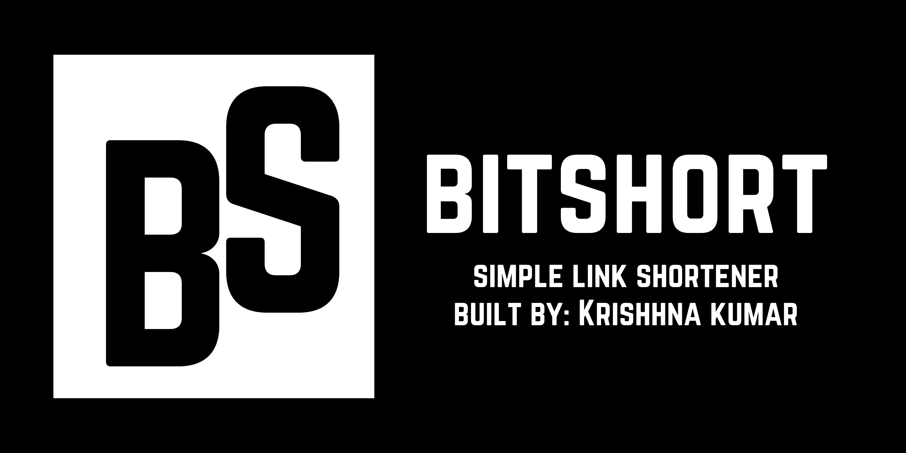

Bitshort
A simple URL shortener built with FastAPI, SQLite, and Jinja2.

Features · Tech Stack · Getting Started · Project Structure

About
Bitshort is a small web application that helps turn long website addresses into short codes. You can submit a URL to generate a code, or search using a saved code or the original URL to reach its destination.

The project uses a minimal black-and-white interface, with Norwester for display text and Inter for supporting text.
Features
- Shorten URLs — submit a website address and generate a five-character alphanumeric code.
- Search saved links — look up a saved link using its short code or original URL.
- URL validation — accepts URLs with http:// or https://, and adds https:// when a domain is entered without a scheme.
- Persistent storage — stores generated codes and URLs in a local SQLite database.
- Responsive interface — simple pages for the home, shorten, search, and success flows.
Tech Stack
Technology	Purpose
Python	Application logic
FastAPI	Web framework and request handling
SQLite	Stores short codes and original URLs
Jinja2	Renders HTML templates
HTML and CSS	User interface
Google Fonts (Inter)	Supporting typography
Norwester	Display typography

Getting Started
1. Clone the repository
git clone https://github.com/krishna12q/bitshort.git
cd bitshort
2. Create a virtual environment
Windows
python -m venv .venv
.venv\Scripts\activate
macOS / Linux
python3 -m venv .venv
source .venv/bin/activate
3. Install dependencies
pip install fastapi uvicorn jinja2 python-multipart
4. Run the application
uvicorn app:app --reload
Open http://127.0.0.1:8000 in your browser.

The SQLite database (db.db) and its urls table are initialized by database_backend.py when the application starts.
How to Use
1. Open the home page.
2. Select Shorten and enter a website address, such as github.com/krishna12q.
3. Submit the form to generate a short code.
4. To find a saved destination, select Search and enter either the generated code or the original URL.
Project Structure
bitshort/
├── app.py
├── database_backend.py
├── db.db
├── static/
│   ├── Bitshort_Banner.png
│   ├── Bitshort_Logo.png
│   ├── norwester.otf
│   └── style.css
└── templates/
    ├── index.html
    ├── search.html
    ├── shorten.html
    └── succsess.html
Notes
- The database is stored locally in db.db.
- The current implementation generates five-character codes using uppercase letters and digits.
- Searching for a saved code or URL redirects to the original destination.
- This is a learning and portfolio project. It is not yet intended as a production URL-shortening service.
Author
Krishna Kumar
- GitHub: @krishna12q
- Repository: krishna12q/bitshort

Made by Krishna Kumar

